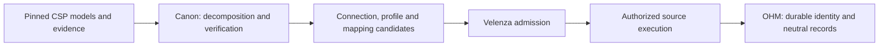

# Cloud connection factory completion map

The factory belongs in the existing Arbor stack. Canon retains API evidence and builds candidates; Inarch retains source history, Cambium connects implementation evidence, Trellis tracks completion, and Canopy consumes independently justified control evidence. No additional peer stack is needed for the four inventory cases. Customer credentials, admission and durable ingestion remain Velenza responsibilities.

The first three boxes can be prepared in Arbor before the runtime is ready. The remaining boxes require their Velenza owners; creating a candidate does not execute any of them.

## Reuse and decomposition

The composition is provider → service → API surface/version → resource → operation. A resource may participate in several operations and an operation may concern several resources, so these are typed graph references, not duplicated nested documents.

The provider owns common authentication requirements and common profile definitions. A service composition references those definitions and carries its signing-service name, endpoint rules, API version, wire protocol, paging and permission residuals. It cannot widen another service's credential grant. The customer source identity is distinct from the provider catalog identity; updating a model or mapping does not create another customer source.

Each selected response object has a complete source field roster derived from its retained model. Each direct field, or every leaf of an explicitly decomposed parent, receives a checked disposition. A private or unsupported disposition is visible unfinished semantic coverage, not a successful translation. Nested selection preserves source cardinality and documented wire names. Service-specific lifecycle translations and unit evidence are data consumed by shared machinery.

## What the source-neutral owner covers

Infrastructure Resource Record version 2 declares scope, storage container, compute instance and compute volume. Its machine-readable target schema is a closed contract, bound to the exact canonical owner and validator profile. The portable export keeps those hashes and coordinates separate from its own byte hash.

The contract covers opaque identity, explicit scope references, labels, selected observed configuration, lifecycle, timestamps, exact byte capacities and bounded attachment relationships. Presence is explicit: present, absent, not observed, unsupported, unknown, inaccessible, redacted and permitted null are distinct. Required fields may carry a legal uncertainty arm; a missing provider fact cannot become a fabricated positive fact.

This is a foundation for nine selected acquisition mappings over six resource types, not an exhaustive ontology for an IT department. Networks, subnets, routes, security groups, firewall rules, IAM principals and policies, databases, containers, serverless functions, keys, certificates, DNS, logs, billing and software inventory still need their owning semantic declarations and evidence-backed mappings. Add those under their proper owners instead of putting provider JSON into a catchall field. Effective reachability, exposure, permission and compliance require their own assessment evidence; configuration observations alone do not establish them.

Version 2 replaces the singular attachment field with an unordered collection of zero through 1024 resolved instance references. Observed zero is a present empty set; missing data is a distinct state. Duplicates, unresolved references, cross-scope bindings and excess cardinality refuse rather than truncate. A mapping-generation successor handles migration; version 1 records are not silently rewritten. A provider SKU or machine-type URL is not automatically a neutral machine class. Provider IDs remain private lookup keys and never become neutral identities by spelling them differently.

## Completion sequence

| Boundary | Prepared here | Completion evidence still required |
|---|---|---|
| Canonical hierarchy | Provider/service roles, resource/operation relationships and shared profile rules | Successors for newly supported capabilities; keep references and graph projections current |
| API evidence | Four retained official models, explicit supplemental resource associations and pinned supporting documentation | Current qualified source capture and accepted evidence manifests; assertions remain unqualified until verified |
| Catalog compatibility | Parsers and protocol evidence; separate graph-store role compatibility and native candidate adapter | Full classification and derivation proofs, closure/gap context and production verifier acceptance; the five-role builder's nested catalog is not a native plan |
| Shared profiles | Common provider definitions plus service and operation residuals | Eligible customer-specific grants, approved scope and signing implementation evidence |
| Source mapping | Model-derived complete dispositions, exact target schema and checked projection recipes | Broader field coverage, independently justified mappings and lifecycle succession proofs |
| Offline records | Synthetic response fixtures exercise selected neutral records and refusal cases | Actual customer response conformance under authorized access |
| Factory assembly | Five-role candidate assembly and existing compiler plumbing | Complete qualified source package through production verification; no test verifier or candidate commitment can substitute |
| Admission | Candidate references preserve the admission boundary | Single signed admission ceremony with protected typed rows and evidence |
| Runtime acquisition | Declared operation, source and credential requirements | Source-capable execution path, AWS signing, Google token acquisition, bounded retries and pagination under real grants |
| OHM publication | Neutral record owner, source identity contract and mapping candidates | Durable source receipt, identity allocation/resolution, currentness, exact mapping generation, idempotent publication and audit |
| Reconciliation | Offline coverage and continuation uncertainty; no deletion inference | Interrupted/replayed/reordered observations, revoked access, scope completeness, mapping cutover/rollback and recovery in the running system |

The native operation identity is deliberately separate from catalog revision identity. A supplied source-package crosswalk must bind each selected catalog operation to its source symbol and canonical source-operation identity. The adapter recomputes the operation symbol and relationship IDs; mismatches and missing selected relationship contexts refuse. The supplied crosswalk and gaps are still candidate inputs until the actual verifier reexecutes their classification, derivation and applicability proofs.

The retained-model verifier tests use immutable repository snapshots of the exact upstream bytes. The origin URI and capture pin remain separately recorded in `testdata/cloudapi/native-source-snapshots.json`; a snapshot coordinate never rewrites the original source. Test-only authority and derivation scaffolding establish execution conformance, not provider authentication, a qualified semantic interpretation or a current production generation. A test fixture's successful receipt cannot replace those owners.

The order matters: first qualify the exact evidence and mapping bundle; then admit it; then exercise acquisition and durable OHM publication. A working kernel alone does not finish the factory or the provider integrations.

### Remaining work before runtime

These are concrete work packages outside the kernel. Their authority cannot be replaced by a successful offline fixture.

| Work package | Existing owner or implementation seam | Required completion proof |
|---|---|---|
| Production source qualification | `DocumentationFactoryProductionSourceVerifier` in `internal/providerplan/source_package_production.go`; the shipped `cmd/provider-documentation-factory-run/main.go` currently passes `nil` | A boot-selected implementation authenticates the admitted evidence producer, resolves the current generation and verifies the complete exact evidence identity set. Wrong producer, stale generation, partial sets, substituted bytes and test-owned receipts refuse. A package or CLI argument cannot choose its verifier. |
| Production authority and derivation package | OOD Graph Protocol and the source-package authority, classification, applicability and derivation owners | The exact canonical authority must meet the existing verifier's locked-authority contract. Publish qualified source classifications, operation/resource crosswalks, field contracts, mapping recipes and explicit gaps for each supported operation; retain their full dependency closure. Test authority is not a substitute. |
| Authoritative Canon API materialization | `api_relationship.go`, which currently returns `ErrAPIElementRoleEvidenceVerifierUnavailable` | Implement and independently accept the OOD evidence verifier and its complete evidence-row/receipt closure before materialization. A locator hash alone must continue to refuse. No database migration or graph publication is performed by this work. |
| Reusable profile qualification | Extension Protocol's API shape/profile composition and Connector Vault's eligibility contract | Qualify the shared provider profile plus the smallest service/operation residual. Verify endpoint partition/region rules, SigV4 signing-service parameters or Google token audiences/scopes, pagination, retry classes and permission requirements. Two services may share a profile without sharing an ineligible customer grant. |
| Semantic coverage expansion | Infrastructure Resource Record, Business Record Class Contract and OHM/Source Record and Semantic Projection | Resolve each explicitly unsupported field to an evidence-backed owner declaration and recipe, a justified private disposition or a retained unsupported result. Add exact-value and uncertainty fixtures before promoting coverage. Broader services require their proper neutral classes, not an arbitrary provider-payload property. |
| Mapping succession and acquisition package | Extension Protocol factory outputs and OHM source identity/currentness owners | Produce source-instance configuration, coordinate extraction, update comparison, acquisition/reconciliation policy, mapping-generation transitions and lineage references as candidates. Prove stable source identity across credential rotation and API/model upgrades, and reject incomplete-page deletion or stale-generation overwrites. Live durability still requires runtime acceptance. |
| Linked delivery evidence | Canon, Inarch, Cambium, Trellis and Canopy | Bind exact source snapshot → owner/profile versions → generated package → implementation/test revision → independent acceptance. Add admission and runtime evidence only when those events actually occur. Graph search results and repository delivery do not confer admission. |

The original cross-repository research and contract inventory is retained in [the CSP factory gap analysis](https://github.com/velenzaboc/no13-infra/blob/56012bb70b42193b49bd7ffb2cc8a29a42d3f7b1/docs/research/csp-api-factory-20261029/factory-arbor-gap-analysis.md). Its dated implementation observations remain historical evidence; this completion map records the newer offline preparation and its remaining boundaries.

## Four final acceptance cases

S3 and Cloud Storage exercise storage containers, pagination and shared provider profiles. EC2 and Compute Engine each exercise instances and volumes/disks, nested response structures, lifecycle translations, exact capacities and scoped references. They yield nine operation targets over six resource types across four services and two provider compositions. S3 includes ListBuckets, GetBucketVersioning, GetBucketEncryption and GetPublicAccessBlock. Detail calls bind their resource identity to the exact documented request Bucket member; they do not fabricate a response key or prove that a live acquisition ran.

The positive fixtures use synthetic customer values against the retained official model structures. Negative cases must reject ambiguous bindings, unsupported enum values, malformed types, unknown positive facts, invalid units and unsupported relationship cardinality. Empty responses are valid zero-record observations. Partial pages, inaccessible scopes and revoked access never authorize deletion.

The selected mappings have complete field accounting, with deliberately limited semantic coverage:

| Operation / selected object | Direct model fields | Mapped facts | Private | Unsupported |
|---|---:|---:|---:|---:|
| S3 ListBuckets / Bucket | 4 | 2 | 0 | 2 |
| S3 GetBucketVersioning / output | 2 | 1 | 0 | 1 |
| S3 GetBucketEncryption / output | 1 | 1 | 1 | 2 |
| S3 GetPublicAccessBlock / output | 1 | 4 | 0 | 0 |
| EC2 DescribeInstances / Instance | 61 | 2 | 1 | 59 |
| EC2 DescribeVolumes / Volume | 23 | 6 | 8 | 17 |
| Cloud Storage buckets.list / Bucket | 38 | 6 | 12 | 32 |
| Compute instances.aggregatedList / Instance | 48 | 4 | 1 | 43 |
| Compute disks.aggregatedList / Disk | 50 | 5 | 1 | 44 |

The 228 direct source fields become 255 dispositions after selected nested decomposition: 31 mapped facts, 24 private and 200 unsupported. These counts measure explicit mapping coverage, not complete CSP/CNAPP support. Scope and neutral identity are separately bound rather than copied source facts.

Storage mappings now include reported time, versioning, a bounded default-encryption rule observation, four distinct public-access-block configuration flags, retention lock, customer-managed-key configuration and public-access-prevention configuration where the source documents them. Each enum/boolean recipe consumes exact documentary byte bindings and refuses unknown values. Missing configuration does not mean disabled or unencrypted. The encryption-rule projection requires exactly one observed rule; it refuses zero or multiple rules instead of selecting the first.

Compute mappings add descriptions, reported creation times where they actually mean creation, volume encryption observations, lifecycle transitions and multiple attachments. EC2 LaunchTime remains private because it is the last launch time. GCP DEPROVISIONING is an explicit unsupported enum until its meaning is independently justified; a declared enum label alone is not semantic evidence.

The cases deliberately distinguish AWS EC2's permanent `terminated` state from Google Compute Engine's restartable `TERMINATED`, and distinguish mutable S3 reported creation time from incarnation evidence. These differences demonstrate why matching names and types is insufficient for semantic translation.

Azure remains a later provider. This implementation consumes Smithy JSON and Google Discovery REST models; Azure ARM/OpenAPI parsing, Entra authentication profiles, service residuals and owner-backed mappings still need their own retained evidence and acceptance cases.

Future services follow the same sequence: capture and pin a model; declare evidence-backed resource/operation relationships; reference compatible provider profiles; declare all field dispositions; load an exact neutral owner; attach justified recipes and fixtures; qualify the bundle; admit it; prove durable ingestion. Automatic generation can propose this work, but cannot manufacture missing semantics, credential eligibility or admission authority.
